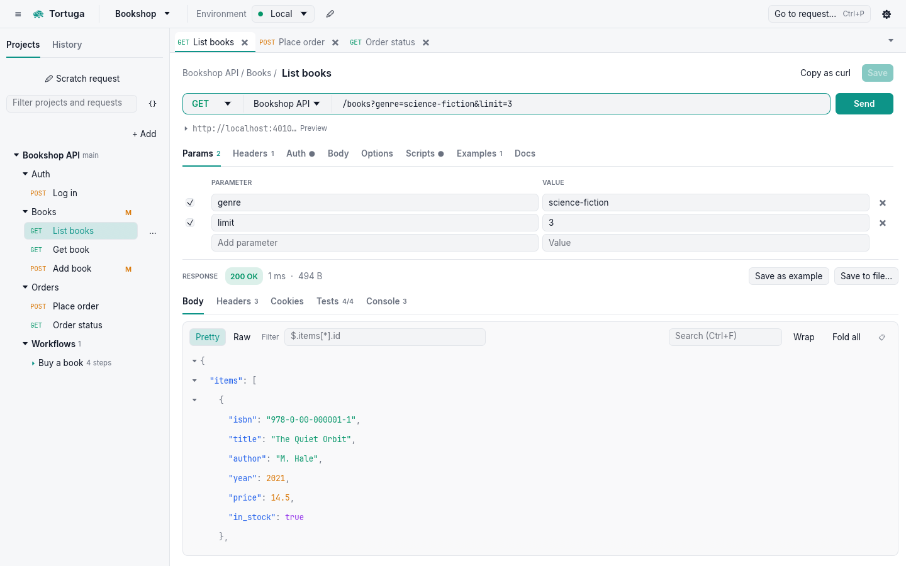

# Tortuga 🐢

**A fast, git-friendly API client for developers.** Your requests live as plain files in your repository, next to the
code they call, and your team shares them with the git workflow it already has. No account, no cloud, no sync service.

[](https://github.com/sorensenNiels/tortuga/actions/workflows/ci.yml)
[](https://github.com/sorensenNiels/tortuga/releases)
[](#license)

<picture>
  <source media="(prefers-color-scheme: dark)" srcset="docs/images/screenshot-dark.png">
  
</picture>

## Why Tortuga

- **Requests are code.** A project is a folder of small TOML files, one per request. Pull requests show exactly which
  request changed and how, and a `git pull` brings in your teammates' changes without an import step.
- **Nothing leaves your machine.** No sign-in, no telemetry, works offline. Secret values (tokens, passwords) stay on
  your computer; only their names go into the files you commit.
- **Fast and native.** Written in Rust, for Windows, Linux and macOS. It starts in a moment and stays quick with large
  responses.
- **Bring what you have.** Import OpenAPI 3, Postman collections (with their scripts translated), Insomnia, Bruno and
  `.http` files, or paste a `curl` command.
- **Test it, then run it in CI.** Tests, captures and scripts in JavaScript; workflows that chain requests, run per
  row of a data file, and poll until a job is done. `tortuga-cli` runs the same files in your pipeline and writes
  JUnit or JSON reports.
- **Mock the API before it exists.** Saved example responses become a local mock server, and responses are checked
  against them.
- **Catch mistakes before you push.** `tortuga-cli check` finds missing variables, broken workflow steps and
  credentials typed into request files. `tortuga-cli diff` summarises API changes in a pull request.
- **Works with your tools.** A VS Code extension, and an MCP server so AI coding agents can read and send your
  requests.

## Install

Download the installer for your OS from the [releases page](https://github.com/sorensenNiels/tortuga/releases):

| OS | File | Install |
|---|---|---|
| **Windows** | `.msi` | Run it. If SmartScreen warns, choose **More info → Run anyway**. |
| **macOS** | `.dmg`, one for Apple silicon (`aarch64`) and one for Intel | Drag Tortuga to Applications. The first time, right-click it and choose **Open**: the app is not signed yet. |
| **Linux** (Debian, Ubuntu) | `.deb` | `sudo apt install ./tortuga_*.deb` |
| **Linux** (other) | `.AppImage` | `chmod +x tortuga_*.AppImage`, then run it. |

The same page has `tortuga-cli`, the command-line runner for CI, as a `tortuga-cli-<version>-<os>` archive.

## Getting started

This takes about five minutes and ends with a request your teammates can use.

1. **Send a request.** The *scratch request* at the top of the sidebar is for quick calls. Type a URL, or paste a
   `curl` command (from API docs or the browser's "Copy as cURL") and the method, headers and body are filled in.
   Press **Ctrl+Enter** to send.
2. **Create a project in your repository.** Choose **+ Add → New project…** in the sidebar and pick a folder in your
   API's git repository, such as `api-requests/`. If you have an OpenAPI description or a Postman, Insomnia, Bruno or
   `.http` collection, use the matching **+ Add → Import…** instead: it creates the project with its requests,
   environments and auth.
3. **Add environments and servers.** In the project's **…** menu, open **Environments…**. Add your environments (for
   example *Local* and *Staging*), a server with a base URL for each, and the variables your requests need. Mark
   credentials as **secret** (🔒): only the name is saved in the files, the value stays on your machine.
4. **Save requests to the project.** **Save to project…** keeps the scratch request; **Ctrl+S** saves later edits. Pick
   the server in front of the URL field and type only the path, so one request works in every environment.
5. **Add a test.** In the request's **Scripts** tab:

   ```js
   test("status is 200", () => expect(res.status).toBe(200));
   ```

   Send again and the response's **Tests** tab shows the result.
6. **Commit and push** the project folder like any other change. Colleagues open it with **+ Add → Add existing
   projects…**, and CI can run it:

   ```sh
   tortuga-cli run api-requests --env Staging --report junit --out results.xml
   ```

Press **Ctrl+K** at any time for every command, and **Ctrl+P** to find a request by name or URL.

## Working as a team

Tortuga has no server and no sign-in: your team shares requests through **git**, the same way you share code.
A Tortuga *project* is a folder of plain TOML files, usually kept in the repository of the API it calls:

```
my-api/                          your API's git repository
├── src/ …
└── api-requests/                a Tortuga project
    ├── tortuga.toml             project name, servers, variables (names of secrets only)
    ├── environments/            one file per environment: base URLs and values
    ├── users/                   a folder of requests
    │   ├── _folder.toml         folder defaults (headers, auth), if any
    │   ├── get-user.toml        one file per request
    │   └── create-user.toml
    └── workflows/               chained requests with checks
        └── user-lifecycle.toml
```

A request file is short and readable in a diff:

```toml
name = "Get user"
method = "GET"
server = "api"
url = "/users/{{user_id}}"

[scripts]
tests = """
test("found", () => expect(res.status).toBe(200));
"""
```

### What is shared and what stays on your computer

| Shared through git (commit it) | Stays on your computer (never in the repository) |
|---|---|
| Requests, folders and folder defaults | Values of **secret** variables (tokens, passwords) |
| Servers and their base URLs per environment | Which environment you have selected |
| Variables and their non-secret values | Your workspaces (unless you save one as a file, with its variables) |
| Test and pre-request scripts, captures | Cookies, history, unsaved edits |
| Workflows and their data files | Settings, e.g. your company's CA certificate |

Tortuga writes nothing local into the project folder, so you don't need a `.gitignore` for it.

### Set up a project (done once, by one person)

1. In your API's repository, choose **+ Add → New project…** in the sidebar and pick (or create) a folder such as
   `api-requests/`. If the API has an OpenAPI description, **+ Add → Import OpenAPI…** creates the project with
   its requests, environments and auth for you; coming from Postman, **+ Add → Import Postman collection…** does the
   same with an exported collection, and **+ Add → Import .http file…** with the `.http` files of the VS Code REST Client or
   JetBrains HTTP Client. Then continue with step 4.
2. In the project's **…** menu, open **Environments…**. Add your environments (e.g. *Local*, *Dev*, *Staging*),
   your servers with a base URL for each environment, and the variables the requests need. Mark credentials as
   **secret** (🔒): only the variable name goes into the files, the value stays on your machine.
3. Add the requests the team uses. Pick the server in front of the URL field and type only the path, so one request
   works in every environment.
4. Commit and push the folder like any other change.
5. Optional: if the team works across several repositories, choose **Save as file…** in the workspace menu (title
   bar) and commit the `.tortuga-workspace.toml` file. It lists the projects (by path in its own repository,
   by clone URL in others, so teammates can clone them anywhere) and the workspace variables.

### Join as a colleague

1. [Install Tortuga](#install) and clone the repository.
2. Open the project: **+ Add → Add existing projects…** and pick the repository folder. Tortuga lists every project
   in it. Or, if the team committed a workspace file, open it with **Open workspace file…** in the workspace menu.
   Projects in other repositories are found in clones you already have open in Tortuga; the ones it can't find show
   as *missing* with **Copy clone URL** and **Locate…**. Where you put a clone stays on your machine.
3. Choose an environment in the title bar.
4. Fill in your own secrets: open **Environments…** in the project's **…** menu and type your value for each 🔒
   variable. Requests that use a variable without a value are highlighted, and Tortuga won't send them until it
   has one.

### Day to day

- **Change requests and commit them.** Each request is its own small file, so a pull request shows exactly which
  requests changed and how. Commit, pull and push with your usual git tools; the project's **…** menu has **Open in
  terminal** and **Open in file manager**.
- **Your teammates' changes appear by themselves.** After a `git pull` or a branch switch, Tortuga reloads the
  project; there is no import step.
- **See what you changed.** The sidebar shows the branch next to each repository, and marks requests as **M**
  (modified), **N** (new), **D** (deleted, struck through until committed) or **C** (merge conflict).
- **Conflicts.** If a request you are editing changes on disk, a banner asks whether to **Keep mine** or **Take
  theirs**. A file with git conflict markers shows as ⚠; fix it in your editor, or delete it in Tortuga.
- **Hand something over quickly.** **Copy as curl** (next to Save) gives a teammate a command they can run anywhere.
  You choose whether to mask secret values.
- **Run the same checks in CI.** `tortuga-cli` runs the committed workflows and requests without a window. Pass
  secrets as `TORTUGA_VAR_<name>` environment variables (see [In CI](#in-ci) below).

Keep everything a request needs inside the project, such as files to upload in a `fixtures/` folder and data files
for workflows. Then the request works on every teammate's machine.

## Feature guide

### Workspaces, environments and variables

**Workspaces and projects.** A *project* is a folder with a `tortuga.toml`, typically inside your API's git
repository. Requests are saved as one `.toml` file each and folders are directories, so you share them with
`git add`, `commit` and `push` like any other file. A *workspace* (switcher in the title bar) is the set of projects
you work on together; several projects may live in one repository, and the sidebar groups them under it.

- **+ Add → New project…** creates a project in a folder (and can make it a git repository).
- **+ Add → Add existing projects…** finds every project in a folder or repository.
- **Save as file…** in the workspace menu writes a `.tortuga-workspace.toml` you can commit; teammates open it with
  **Open workspace file…** and see which repositories to clone.
- **Variables…** in the workspace menu holds variables every project in the workspace can use, such as a tenant id
  or an API key several services share. A project's own values win over them. They are saved in the workspace file;
  mark one secret (🔒) and only its name is, while each person's value stays on their machine.

Use an item's **…** menu (or right-click it) to add, rename, duplicate, move, reorder or delete. **Ctrl+S** saves,
**Ctrl+Enter** sends.

**Environments and servers.** Environments belong to the workspace: one list (e.g. *Development*, *Staging*) that
every project has. Open **Environments…** from the workspace menu, a project's **…** menu, or ✏ next to the environment
picker:

- Add, rename, reorder or remove environments, and give each a colour or mark it **Protected**, once for all projects.
- Under **All projects**, set values every project shares: variables, and base URLs of servers by name (*Users API*
  goes to every project's server called *Users API*).
- Under each project, fill in only what differs for it: its servers' base URLs and its own values. Empty fields show
  what they inherit, greyed.
- Under **Servers and variables**, define a project's servers and variables, their defaults, and which are secret:
  their values stay on your machine.

In a request, pick the server in front of the URL field and type only the path (`/users/{{user_id}}`). The picker in
the title bar switches every project at once. Variables that aren't defined are highlighted, and the request isn't
sent until they are. An environment a project brings along (one you open or pull) joins the list by itself.

**Dynamic variables** get a new value wherever they are used, on every send: `{{$guid}}` (or `{{$uuid}}`),
`{{$timestamp}}` (seconds), `{{$isoTimestamp}}`, `{{$randomInt}}` (0–1000), and `{{$randomInt 1 10}}` or
`{{$random.integer(1, 10)}}` (1 to 9). They work in the mock's example responses too.

**Settings for a workspace or a project.** Timeout, following redirects and cookies come from Settings, but a
workspace (**Defaults…** in the workspace menu) or a project (**Defaults (headers, auth, requests)…** in its menu) can set
its own on the **Requests** tab; the nearest wins, and every field shows what it inherits and from where. A workspace's
**Defaults…** also has headers and auth that every project inherits below its own, such as one `X-Tenant` header or one
bearer token for all your services. Project settings are saved in `tortuga.toml`, workspace ones in the workspace file,
so the team shares them. Turning off TLS verification stays a setting of your own machine.

**Folder defaults.** A folder's **…** menu has **Folder defaults…**: headers, auth and variables for every request in
that folder. They are saved in the folder's `_folder.toml`, so they are shared through git like the requests.

### Requests and responses

The scratch request (top of the sidebar) is for quick one-off calls; **Save to project…** keeps it.

**Moving around.** **Ctrl+P** (or **Go to request…**) finds any request in the workspace by typing part of its name,
folder or URL. **Ctrl+K** lists every command (send, save, switch environment, settings, …).

**Tabs.** A click opens a request in the *preview tab* (title in italics), which the next click replaces, so browsing
doesn't pile up tabs. Double-click the tab or the request, or edit it, and the tab stays. With requests from several
projects open, each project's tabs are grouped behind a coloured chip; click the chip to fold the group away.
**Ctrl+Tab** goes back to the previous tab, **Ctrl+PageDown/PageUp** to the next/previous one, **Ctrl+W** closes it
(unsaved edits are kept).

**From curl to request.** Paste a `curl` command (e.g. from API docs or the browser's "Copy as cURL") into the URL
field: method, URL, headers, body and auth are filled in. In a saved request this is an unsaved change; **Revert**
undoes it.

**Responses.** **Ctrl+F** searches the body. Above a JSON body, **Filter** takes a JSONPath expression such as
`$.items[*].id` or `$..users[?(@.active == true)].email`; above an XML body, an XPath expression such as
`//order[@status='paid']/@id` (a name without a prefix matches any prefix, so `//Body` finds `soap:Body`). The **Preview** tab of the request shows exactly what will be
sent, with secret values masked.

**History.** The **History** tab in the sidebar lists what you sent, per day. Click an entry to see that response;
**Restore request** brings back the request as it was then. History stays on your computer; **Clear** removes it.

**Uploads.** Choose the **Multipart** body type to send form fields and files. Keep files to upload inside the project
(e.g. a `fixtures/` folder) and they are saved with a path relative to it, so the request works for teammates too.

**Descriptions.** A request's **Docs** tab, and **Description…** in a project's or folder's **…** menu, hold a
description in Markdown, shown rendered; **Edit** switches to the text. It is saved in the file it describes, so it is
reviewed in git with the requests. Imported Postman collections and OpenAPI descriptions bring theirs along.
Unsaved edits are kept when you close Tortuga. **Copy as curl** (next to Save) copies the request with variables
filled in; if it uses secret values, you choose whether to mask them.

**Reordering.** Drag requests and folders in the sidebar to reorder them or move them into a folder. In the
environments dialog, drag the ☰ handle of an environment or server to change their order.

### Importing

**From an OpenAPI description.** **+ Add → Import OpenAPI…** turns an OpenAPI 3 file (JSON or YAML) into a new
project: a folder per tag, a request per operation with its parameters and an example body, the spec's servers as
environments, and its security schemes as auth that uses secret variables. The dialog shows what you'll get and where
before anything is written; afterwards, fill in the secret values under **Environments…**. Swagger 2.0 files need to be
converted to OpenAPI 3 first.

**From Postman.** Export the collection from Postman (*Export → Collection v2.1*) and choose **+ Add → Import Postman
collection…**: folders, requests, bodies and variables come along, folder auth and variables become folder defaults,
and a variable such as `{{baseUrl}}` at the start of the URLs becomes a server whose base URL you set per environment.
Credentials become secret variables: values found in the collection are kept on your machine only, never in the
project files. Postman scripts are translated to Tortuga's `vars`, `test` and `expect` when they only use common
`pm` calls (`pm.test`, `pm.expect(…)`, `pm.response…`, `pm.environment.set`, …); a script that uses more of the
`pm` API is kept as comments, translated as far as it went, for you to finish.

**From a .http file.** **+ Add → Import .http file…** turns a REST Client / JetBrains HTTP Client file into a project:
a request per `###` block, named by its `###` title, with `@variables` as project variables and `{{baseUrl}}` as a
server. Credentials in `Authorization` headers become secret variables kept on your machine, and request variables such
as `{{login.response.body.$.token}}` become a capture in the `login` request, so chained requests keep working.

Insomnia and Bruno collections import the same way, from **+ Add**. **Settings → Importers** chooses which importers
it offers.

### Tests, scripts and workflows

**Tests and scripts.** A request's **Scripts** tab holds JavaScript that is saved in the request file and reviewed in
git like code:

```js
// Tests: run after the response arrives; results appear in the response's Tests tab.
test("created", () => expect(res.status).toBe(201));
test("has an id", () => expect(res.json()).toHaveProperty("id"));

// Pre-request script: runs before variables are filled in.
req.setHeader("X-Request-Time", String(Date.now()));
vars.set("run", "nightly");
```

Scripts have `res` (`status`, `headers`, `json()`, `header(name)`, `cookie(name)`, `time`, …), `req`, `vars` (`get`,
`set`, `unset`, `has`, `replaceIn`), `info` (`requestName`, `iteration`, …) and `console.log`; `expect` has the usual matchers (`toBe`, `toEqual`, `toContain`, `toMatch`,
`toHaveProperty`, `toBeLessThan`, … and `.not`). Scripts can't read files or use the network.

**Captures** (under the scripts) put a value from the response into a variable: `$.access_token` (JSONPath),
`xpath://token` (XPath, on an XML body), `header:Location` or `status`. Captured and script-set values are *runtime variables*: they are used by every request
of the project until you close Tortuga, are never saved, and are listed (and cleared) under **Runtime variables…** in
the project's **…** menu.

To share a captured value with the other projects of the workspace, start its name with `workspace.`: a capture
`workspace.token = $.access_token` in the *Auth* project's login request (or `vars.set("workspace.token", …)`) gives
every project `{{token}}`. The workspace menu's **Variables…** lists these values and clears them.

**Workflows** are an add-on: turn them on in **Settings → Add-ons**. **New workflow…** in a project's **…** menu creates a workflow: a list of the project's requests that
run in order, each step with optional extra captures and tests. Values captured by a step are available to the next
ones as `{{variables}}`. Choose a CSV or JSON **data file** to run the workflow once per row. Workflows are saved in
the project's `workflows/` folder, so they are shared through git too. **Run** (or **Ctrl+Enter**) shows each step's
result; click a step for its tests and response.

To **poll** an asynchronous API (`202 Accepted`, then a status URL until the job is done), open a step's **Checks…**
and turn on **Repeat until it passes**: the step is sent again, up to the number of **Tries**, with a **Wait** between
them, until its tests pass. The results show how many tries it took. For other loops, a step's script can choose what
runs next: `workflow.next("Check status")` runs that step after this one, `workflow.stop()` ends the iteration. An
iteration stops after 1000 steps, so a loop that never ends can't hang a run.

### Mock servers

The **mock server** answers with the saved examples of a project's requests (the **Examples** tab, or **Save as
example** on a response), so you can build against an API before it exists. Start it from the project's **…** menu;
it can match examples on headers, query and body. When a request has examples, a response that doesn't match their
status, content type or JSON shape shows as a failed test. `tortuga-cli mock` serves the same mock from a terminal,
and `tortuga-cli run … --mock` runs a workflow against it.

### Command line and CI

#### In CI

`tortuga-cli` runs the same files from a terminal, without a window:

```sh
tortuga-cli run path/to/project user-lifecycle --env Staging --report junit --out results.xml
tortuga-cli run path/to/project users/            # every request in a folder
TORTUGA_VAR_token=$TOKEN tortuga-cli run path/to/project users/get-user.toml --var user_id=42
```

It prints each step with its tests and exits with 0 when everything passed, 1 when something failed and 2 for
usage errors. Pass secrets with `--var name=value` or `TORTUGA_VAR_<name>` environment variables. `--data FILE`
runs once per row; `--report json` writes JSON instead of JUnit XML; `--workspace FILE` also uses the variables and
environments of a `.tortuga-workspace.toml` (the project's own values win), so `--env Staging` finds the workspace's
*Staging*. Download it from a release (`tortuga-cli-<version>-<os>` archive) or build it with `make cli`.

#### Before a push

`tortuga-cli check` reads a project without sending anything and reports what would fail later
or leak: files that don't read, workflow steps naming a request that is gone, `{{variables}}` with no value in some
environment, and values that look like credentials (JWTs, Bearer tokens, AWS, GitHub, Stripe or Slack keys, private
keys, a typed-in Basic password) in the files you commit. It exits with 1 when it finds something, so it fits CI and a
pre-commit hook:

```sh
tortuga-cli check path/to/project --workspace team.tortuga-workspace.toml
```

A finding names its place, never the value (`login.toml: header Authorization: looks like a JWT`). To accept one, such
as a fake token in a test request, list its place in the project's `tortuga.toml`:
`[check]` `allow = ["login.toml: header Authorization"]`. Examples are not scanned.

#### In a pull request

`tortuga-cli diff` prints, as Markdown, what a change does to a project's API: requests added,
removed, moved and changed (method, path, params, headers, auth type, body shape and examples, never values), one row
each, with the details folded away. Changes that may break clients (anything removed, renamed or of another type) are
marked ⚠, and `--fail-on-breaking` makes them fail the build. Revisions read as in git: `main` (against your working
tree; `HEAD` when left out), `main..HEAD`, or `origin/main...HEAD` (since the branch left main, as the pull request
shows it). In GitHub Actions, after `actions/checkout` with `fetch-depth: 0`:

```yaml
- run: tortuga-cli diff api origin/${{ github.base_ref }}...HEAD > api-changes.md
- run: gh pr comment ${{ github.event.pull_request.number }} --body-file api-changes.md
  env:
    GH_TOKEN: ${{ github.token }}
```

### Editors and AI agents

**In VS Code.** The extension in [editors/vscode](editors/vscode/README.md) lists your projects in the Testing view and
runs them with `tortuga-cli`, with an environment picker and "Open in Tortuga". `make vscode` builds it.

**For AI coding agents.** `tortuga-cli mcp` serves a project over the Model Context Protocol, so an agent such as
Claude Code, Cursor or VS Code can list its requests, read them, send them and read the response and test results,
and create, change, move and delete requests and folders (the changes are files you review in git):

```sh
claude mcp add tortuga -- tortuga-cli mcp path/to/project --env Dev
```

Secrets come from `TORTUGA_VAR_<name>` as for `run` and are shown to the agent as `{{name}}`, never their values. In
a protected environment only GET, HEAD and OPTIONS requests are sent; response bodies are cut at 100 KB.

In the app, the MCP server is an add-on: turn it on in **Settings → Add-ons** (add-ons are off by default). Then
**Start MCP server for AI agents** in the workspace menu (or the command palette) serves the whole
workspace at `http://127.0.0.1:4040/mcp` with the environment and secrets chosen in the app; its dialog copies the
configuration for Claude Code, Cursor or VS Code (with a token that changes each start) and logs what agents did.

### Settings

Settings (top right) has these tabs. **Requests**: redirects, cookies, the default timeout, CA certificates (add your
company's CA if your internal APIs use certificates from it), and hosts whose certificates aren't checked, for test
servers with self-signed certificates (only on your machine). **Appearance**: light, dark or system theme, the language
(English or Danish; by default the system's), text size (also **Ctrl+=**, **Ctrl+-**, **Ctrl+0**) and wrapping long
lines in responses (also the **Wrap** switch above a response). **History**: how many sent requests are kept per
project, or none. **Importers**: which importers "+ Add" offers. **Add-ons**: workflows, the mock server, the MCP
server and GeoServer tools, each on or off.

## Status

Tortuga is before 1.0 and is released often (see the [changelog](CHANGELOG.md)). It is built and
tested on Linux and Windows; the macOS builds are made by CI but have not been tried on a Mac yet. A web version may
follow. [docs/FEATURES.md](docs/FEATURES.md) lists what works and how it was checked, and
[docs/ROADMAP.md](docs/ROADMAP.md) has the plan. Ideas and bug reports are welcome as
[issues](https://github.com/sorensenNiels/tortuga/issues).

## Development

### 1. Install the prerequisites (once per machine)

You need `git` and `make`. Then run the setup for your OS. It installs the system libraries the desktop
app needs, the Rust toolchain (version pinned in `rust-toolchain.toml`), and the cargo tools
`cargo-deny` and `cargo-nextest`.

| OS | Command | What it installs |
|---|---|---|
| **Linux** (Ubuntu/Debian, Fedora, Arch) | `make setup` | GTK 3 dev package, `libxkbcommon-x11` and OpenGL libraries (asks for your sudo password), Rust, cargo tools |
| **WSL2** | `make setup` | Same as Linux. The app window opens through WSLg (Windows 11, or Windows 10 with WSLg). |
| **macOS** | `make setup` | Xcode Command Line Tools (if missing), Rust, cargo tools |
| **Windows** | `powershell -ExecutionPolicy Bypass -File scripts\setup-windows.ps1` | MSVC Build Tools, GNU make, Rust, cargo tools |

On Windows the first run installs `make`, so call the script directly; afterwards `make setup` works too.
Open a new terminal after setup so the updated `PATH` is picked up.

### 2. Run the app

```sh
make run          # desktop app
```

The first build takes a few minutes; later builds are incremental.
In VS Code, press F5 to debug ("Debug Tortuga (desktop)").

### 3. Check your changes

```sh
make verify       # formatting, lints, all tests, dependency checks: the same as CI
```

[CLAUDE.md](CLAUDE.md) describes the coding conventions, and [docs/RELEASING.md](docs/RELEASING.md) how installers
and releases are built.

### Make targets

| Target | What it does |
|---|---|
| `make setup` | One-time machine setup (see above). |
| `make run` | Run the desktop app. |
| `make run-web` | Preview the web build in a browser with [trunk](https://trunkrs.dev) (`cargo binstall trunk`). Experimental: browsers block most cross-site API calls (CORS). |
| `make verify` | Everything CI checks: `fmt-check`, `lint`, `test`, `deny`. |
| `make test` | All tests. `make test-core` runs only the engine tests, `make test-ui` only the UI tests. |
| `make lint` | Clippy with warnings as errors, for the desktop and web targets. |
| `make fmt` | Format all code. |
| `make deny` | Check dependency licences and security advisories. |
| `make build` / `make release` | Debug / optimised build of the desktop app. |
| `make cli` | Optimised build of the command-line runner, `target/release/tortuga-cli`. |
| `make package` | Installers for this OS in `target/packages/` (see [docs/RELEASING.md](docs/RELEASING.md)). |
| `make startup-time` | Open the optimised app with your workspace, print how long start-up took, and quit. |
| `make doc` | Build and open the API documentation. |
| `make vscode` | The VS Code extension as a `.vsix` in `editors/vscode` (needs Node.js). |
| `make vscode-test` | The extension's unit tests, then VS Code started on `selftest/` with it loaded (needs a display). |
| `make clean` | Remove build output. |

On Linux without the GTK 3 headers installed, `make test` and `make lint` still check everything that can be built
(engine, UI and its tests, CLI, web target) and tell you what was skipped; `make run` asks you to run `make setup`.

### Project layout

```
crates/
  tortuga-core/    The engine: request model, HTTP execution, projects, variables, workspaces, scripts and
                   workflows. No UI code.
  tortuga-ui-egui/ The user interface (egui): components and UI state. No platform code.
  tortuga-app/     Launches the UI on desktop (web later) and provides files, dialogs and settings storage.
                   Builds the `tortuga` binary.
  tortuga-cli/     The command-line runner for workflows and tests in CI (`tortuga-cli` binary). No GUI libraries.
editors/vscode/    The VS Code extension over `tortuga-cli` (TypeScript).
selftest/          Tortuga testing itself: workflows that run against their projects' mocks in `cargo test`.
docs/
  ROADMAP.md       The plan: vision, phases, requirements, ideas and decisions.
  FEATURES.md      What is implemented and verified, per requirement.
  REQUIREMENTS.md  The agreed text of every implemented requirement.
scripts/           One-time setup per OS (used by `make setup`).
```

### Troubleshooting

| Problem | Fix |
|---|---|
| `make run` says GTK 3 is missing | Run `make setup` (Linux needs the `libgtk-3-dev` package). |
| `Library libxkbcommon-x11.so could not be loaded` | Install `libxkbcommon-x11-0` (Debian/Ubuntu; `make setup` does this). Needed when the app runs on X11. |
| `libEGL warning: egl: failed to create dri2 screen` in WSL | Harmless: Mesa found no `/dev/dri` and fell back to CPU rendering. `make run` sets `GALLIUM_DRIVER=d3d12` under WSL so the GPU is used; set it yourself when starting `tortuga` another way. |
| No window appears in WSL | Check that WSLg works: `echo $WAYLAND_DISPLAY` should print something. Update WSL with `wsl --update` in Windows. |
| `cargo-deny: command not found` | Open a new terminal after `make setup`, or add `~/.cargo/bin` to your `PATH`. |
| Settings file | Saved to `~/.config/tortuga/settings.toml` (Linux), `~/Library/Application Support/dk.SoftDesign.Tortuga/` (macOS), `%APPDATA%\SoftDesign\Tortuga\config\` (Windows). Delete it to reset. |

## License

Tortuga is dual-licensed under [MIT](LICENSE-MIT) or [Apache-2.0](LICENSE-APACHE), at your option.
